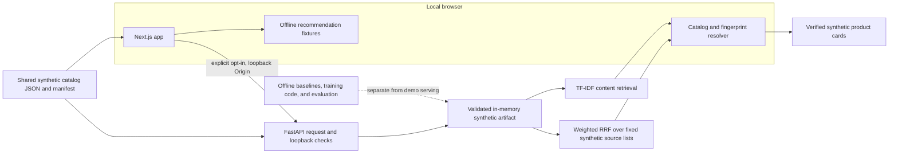

# RecFusion

**Release:** [v1.0.0 — Portfolio Research Prototype](https://github.com/AmarjeetJha17/recfusion/releases/tag/v1.0.0) | **Status:** Published

RecFusion is an evaluation-driven recommendation systems research prototype featuring a reproducible offline ML evaluation pipeline and a local, synthetic-only electronics recommendation application.

The project combines Python, FastAPI, Next.js, TF-IDF content retrieval, weighted Reciprocal Rank Fusion (RRF), deterministic evaluation, and automated quality gates.

**Scope:** Portfolio-ready research prototype. Not a production recommendation service. The local demo uses invented products and synthetic user contexts.

## Included in the v1.0.0 scope

- A Next.js catalog discovery and product-detail interface.
- A shared, versioned synthetic electronics catalog consumed by Python and TypeScript.
- An explicitly enabled FastAPI loopback demo for product-to-product, synthetic-user content, and hybrid recommendations.
- TF-IDF product-content retrieval and existing weighted Reciprocal Rank Fusion (RRF) over fixed synthetic source lists.
- Catalog, compatibility, artifact, and bundle fingerprint validation; verified product cards; source provenance; explicit empty and error states.
- Offline popularity, Item-CF, BPR, Two-Tower, content, and hybrid evaluation code, with frozen synthetic regression scenarios.
- Local quality checks and GitHub Actions jobs for Python and frontend validation.

The v1.0.0 demo does not run a trained collaborative model as a live production service. It does not include a learned ranking stage, bounded agent workflow, authentication, persistent user data, a production model registry, or public serving. PostgreSQL and Qdrant are not required by the local demo.

## Architecture



The dashed edge marks separate research code; the local recommendation API does not train or load a real-data model. See [the current and proposed architecture](docs/ARCHITECTURE.md) for package boundaries and distinctions between implemented and proposed systems.

## Repository areas

| Path | Purpose |
|---|---|
| `apps/web` | Next.js application, fixture provider, optional local API provider, UI tests |
| `apps/api` | FastAPI health/readiness routes and opt-in loopback-only synthetic recommendation API |
| `packages/recfusion_core` | Typed contracts and the shared synthetic catalog asset/manifest |
| `packages/recfusion_data` | Local ingestion, validation, preprocessing, and synthetic release tooling |
| `packages/recfusion_ml` | Offline baselines, retrieval, RRF, model experiments, inference contracts, and evaluation |
| `tests` | Synthetic unit, contract, integration, and frozen-scenario fixtures |
| `docs` | Research evidence, architecture, security, demo, and release records |

## Synthetic catalog and integrity

The demo catalog is `recfusion.synthetic-catalog.v2` with catalog ID `synthetic-electronics-v1`. Its source asset and manifest are in [`packages/recfusion_core/data`](packages/recfusion_core/data). Python packages include both JSON assets. The browser and API compare the exact catalog identity and asset fingerprint; compatibility and recommendation bundle fingerprints are separately defined. The API validates its in-memory recommendation artifact against these values at startup. A mismatch fails closed.

The product names, descriptions, specifications, eligibility, recommendation ordering, and user histories shown in the demo are invented. No real product metadata, current prices, inventory, purchases, or user behavior are presented.

## Local setup

Verified tool versions for the release workflow:

- Python `3.13` (the project requires `>=3.13,<3.14`)
- uv `0.13.1`
- Node.js `24.12.0` in CI; the frontend manifest accepts Node.js `>=20.9`
- pnpm `11.25.0`

From the repository root, install the locked Python dependencies:

```powershell
uv sync --frozen
```

The frontend is independent of the API and starts in offline fixture mode. In a PowerShell terminal:

```powershell
Set-Location apps/web
pnpm install --frozen-lockfile
pnpm dev
```

Open `http://127.0.0.1:3000`. Fixture mode needs no API process and makes no recommendation request.

### Optional local recommendation API

In a second PowerShell terminal at the repository root, enable the development-only synthetic API with the exact frontend origin and a loopback bind:

```powershell
$env:RECFUSION_SYNTHETIC_DEMO_ENABLED = "true"
$env:RECFUSION_SYNTHETIC_DEMO_MAX_CONCURRENCY = "2"
$env:RECFUSION_SYNTHETIC_DEMO_ALLOWED_ORIGIN = "http://127.0.0.1:3000"
uv run uvicorn recfusion_api.main:app --host 127.0.0.1 --port 8000
```

Choose **Local API** in the Recommendation Lab. The service supports product-to-product, synthetic-user content, warm hybrid, and content-eligible hybrid modes. It checks loopback client/server/Host values and the exact configured Origin; the demo is disabled by default and rejected in production. Do not expose it through a tunnel, reverse proxy, or public listener. These checks do not authenticate non-browser local callers.

Stop each process with **Ctrl+C** in its own terminal. Fixture mode remains available when the API is stopped. No `.env`, database, Qdrant instance, account, secret, or external data is needed for the demo.

## Technical walkthrough

Use the 3-5 minute [portfolio demo guide](docs/SYNTHETIC-PORTFOLIO-DEMO.md):

1. State that the catalog and contexts are synthetic.
2. Search, filter, sort, and open a product detail page.
3. Run a fixture product-to-product example and identify its offline boundary.
4. Opt into the local API and show product-to-product and synthetic-user content results.
5. Compare warm-only and content-eligible weighted-RRF outputs, including actual returned counts and contributing source lists.
6. Show catalog/artifact fingerprints and explain that metadata displays only after exact identity checks.
7. Stop the API, show the unavailable/retry state and the still-working fixture path, then restart the API and retry.
8. Close with the research and accessibility limitations below.

## Research evidence

Real and synthetic evidence use different datasets, candidate universes, and evaluation protocols. They must not be combined into one benchmark.

| Evidence | Finding | Limit |
|---|---|---|
| Real Electronics 5-core validation pilot | At K=10, validation-selected Two-Tower reported Recall `0.025889`, NDCG `0.015572`, HitRate `0.033601`, MRR `0.014899`; 31 of 45,331 candidates were recommended (`0.0684%` coverage). | 1,369-user validation cohort; warm train-known candidates only; a single saved checkpoint/selection setup; high concentration; no untouched test evaluation. Review/rating events are not purchases or impressions. |
| Synthetic evaluator and API scenarios | Freeze metric behavior, candidate eligibility, catalog identity, output determinism, RRF source attribution, and empty/error contracts. | Small invented fixtures; they do not estimate real relevance, personalization, commercial uplift, or serving capacity. |

The baseline comparisons, history ablation, confidence-interval caveats, and governance boundaries are documented in [Phase 8 research readiness](docs/PHASE-8-RESEARCH-READINESS.md) and the [research synthesis](docs/RECOMMENDATION-RESEARCH-SYNTHESIS.md). No model is approved for production serving. The private real test split remains unused. Amazon metadata acquisition remains ON HOLD under Phase 4.2C.

## Quality checks and CI

Run the Python checks from the repository root:

```powershell
uv sync --frozen
uv run ruff check .
uv run ruff format --check .
uv run mypy packages apps/api/src
uv run pytest
uv run pre-commit run --all-files
uv build
```

Run the frontend checks from `apps/web`:

```powershell
pnpm install --frozen-lockfile
pnpm run lint
pnpm run typecheck
pnpm run test
pnpm run build
```

GitHub Actions automatically validates the Python backend and Next.js frontend on pushes and pull requests targeting `master`.

The [v1.0.0 release commit](https://github.com/AmarjeetJha17/recfusion/commit/5643dafdc765e37123acffb3063dfdfcd62ba849) passed both hosted quality jobs in the [final CI run](https://github.com/AmarjeetJha17/recfusion/actions/runs/46037492406).

The release baseline includes 375 passing Python tests and 59 passing frontend tests. These checks validate implementation correctness and reproducibility, not real-world recommendation quality.

## Accessibility and security limits

Verified evidence includes the four viewport widths recorded in [the Phase 7.4 accessibility review](docs/ACCESSIBILITY-AND-PORTFOLIO-REVIEW.md), keyboard navigation and search-focus restoration, reduced-motion handling, visible focus, and local demo failure/retry behavior. Paired screen-reader review, exhaustive component-level clipping review, and full WCAG certification remain incomplete. The local demo is not production-ready: it has no authentication or persistent real-user state and must stay loopback-only.

ADR-018 and ADR-019 remain **Proposed**. Phase 4.2C remains **ON HOLD**. This repository is a local research/portfolio prototype, not a public recommendation service or a commercial product feed.

## Release & Documentation

- [v1.0.0 — Portfolio Research Prototype](https://github.com/AmarjeetJha17/recfusion/releases/tag/v1.0.0)
- [v1.0.0 release checklist](docs/RELEASE-V1.0.0-CHECKLIST.md)
- [v1.0.0 release notes draft](docs/RELEASE-V1.0.0-NOTES.md)
- [Current versus proposed architecture](docs/ARCHITECTURE.md)
- [Synthetic demo acceptance evidence](docs/SYNTHETIC-PORTFOLIO-DEMO.md)
