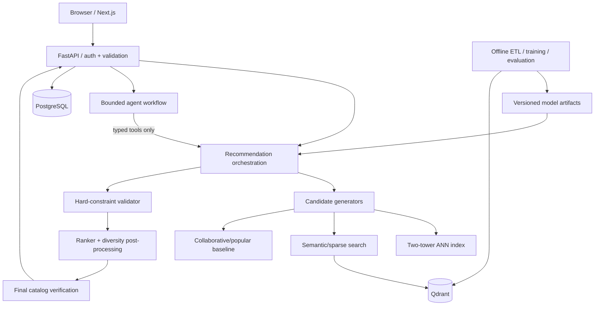

# ARCHITECTURE — RecFusion system design

**Status:** Proposed logical design; repository, API, local infrastructure, and CI foundations are implemented, with no production deployment.

## 1. Architectural style

**Modular monolith** first: Next.js frontend, FastAPI backend, typed domain modules, offline ML jobs, PostgreSQL and Qdrant as external dependencies. Separate training from low-latency inference. Avoid microservices until profiling justifies a split.



## 2. Responsibility boundaries

| Component | Owns | Must not do |
|---|---|---|
| `recfusion_core` | domain entities, DTOs, error contracts | import FastAPI/SQL/vector provider specifics |
| `recfusion_data` | ingestion, validation, versioning, splits | alter online user sessions |
| `recfusion_ml` | baselines, training, ANN retrieval, fusion, ranking, metrics | generate conversational explanations |
| `recfusion_agents` | structured intent, state, tool dispatch, explanation | query DB directly or bypass constraints |
| `apps/api` | auth, API translation, transaction boundaries | train models synchronously |
| `apps/web` | presentation, forms, accessible interactions | expose credentials or override server filters |
| `infra` | environment, service lifecycle, observability | store secrets in Git |

## 3. Request path

1. Validate caller/session and API schema; assign `request_id`.
2. Read catalog version, user profile (if allowed), recent interactions and explicit request; normalize constraints and units.
3. Run eligible candidate retrievers in parallel with bounded timeouts; record source ranks and versions.
4. Deduplicate and validate candidates; **hard filter** by trusted catalog attributes (e.g. category and priced items under cap).
5. Rank with a promoted learned ranker when training/evidence support it, otherwise transparent deterministic score fusion.
6. Apply diversity and duplicate-family policy while preserving hard constraints.
7. Perform final ID, product visibility, source, and constraint validation; attach provenance and reason features.
8. Agent (optional) generates explanations **only from returned validated products** and typed evidence.
9. Persist recommendations/impressions and return versioned JSON; log latency breakdown.

**No matching products:** return explicit empty result with reasons, never fabricate or relax hard constraints.

## 4. Data paths

**Offline:** source JSONL/Parquet → schema/data quality checks → immutable raw versions → dedup and feature derivation → timestamp-aware split → model training → model evaluation → versioned artifact + index; promotion gated on tests.

**Online:** requests + consented interactions → append-only event record → application state updates; future offline training consumes an approved event snapshot, not live transactional tables directly.

## 5. Proposed package organization

```text
apps/api/src/recfusion_api/{main.py,routes/,schemas/,services/,dependencies/}
apps/web/{app/,components/,features/,lib/,tests/}
packages/recfusion_core/{domain/,contracts/,config/}
packages/recfusion_data/{ingestion/,validation/,splitting/,features/}
packages/recfusion_ml/{baselines/,models/,retrieval/,ranking/,training/,evaluation/,inference/}
packages/recfusion_agents/{graph/,nodes/,tools/,prompts/,guardrails/}
configs/{datasets/,models/,experiments/,serving/}
scripts/{data/,training/,evaluation/}
tests/{unit/,contract/,integration/,ml/,agent/,security/,e2e/}
infra/{docker/,compose/,monitoring/}
```

## 6. Suggested typed interfaces

- `CatalogRepository.get_products(ids, visibility_scope) -> products`
- `UserProfileRepository.get_context(principal, consent) -> profile`
- `Retriever.retrieve(context, limit) -> Candidate[]` with model/source version, rank and score.
- `ConstraintValidator.filter(candidates, constraints, catalog) -> (eligible, rejected_reasons)`.
- `Ranker.rank(eligible, context) -> RankedItem[]` with version and feature provenance.
- `RecommendationService.recommend(context) -> RecommendationResponse`.
- `AgentTool.invoke(validated_args, principal) -> typed_result`.

## 7. API envelope and errors

All responses include request ID; recommendation response includes model and catalog versions, applied constraints, data provenance, product IDs and ranks. Errors are typed (`INVALID_CONSTRAINT`, `UNAUTHORIZED`, `NO_ELIGIBLE_PRODUCTS`, `CATALOG_UNAVAILABLE`, `MODEL_UNAVAILABLE`, `RATE_LIMITED`) and must not reveal secrets or SQL details.

## 8. Availability and graceful degradation

These are proposed degradation options, not current behavior. A fallback may
run only when an approved, versioned serving policy declares it, and the
selected strategy must be returned in response provenance; otherwise fail
closed with the relevant typed availability error.

- ANN unavailable → bounded semantic/collaborative or popularity fallback; indicate strategy.
- Ranker unavailable → deterministic fusion.
- LLM unavailable → return factual product cards without prose explanation.
- Catalog unavailable → fail closed (no potentially fabricated products).
- User profile unavailable → consent-respecting guest recommendations.

## 9. Artifact and deployment versioning

A model release pins: model version, feature schema version, training dataset/split manifest, code commit, embedding dimension, ANN index version, evaluation run ID and compatible catalog snapshot. Deployment verifies dimensions and hashes before serving. No hot-swap with mismatched index.

## 10. Open concerns

Hosting budget, identity provider, exact service process layout, embedding/index backfill, observed throughput, retention and automated retraining cadence remain undecided. Record resolution in `DECISIONS.md`.

## 11. Recommendation-serving contract checkpoint

Phase 6.1A records a proposed serving contract in
[`RECOMMENDATION-SERVING-DESIGN.md`](./RECOMMENDATION-SERVING-DESIGN.md).
Phase 6.1B adds a local synthetic-only application service, versioned contracts,
an in-memory synthetic catalog and a validated in-memory content artifact;
details are in [`OFFLINE-RECOMMENDATION-INFERENCE.md`](./OFFLINE-RECOMMENDATION-INFERENCE.md).
The current API still exposes only health/readiness and has no recommendation
route, production artifact registry, promotion flow, or serving-approved
model. The local service resolves an allowlisted policy, checks artifact and
catalog compatibility, retrieves candidate IDs, resolves them through the
synthetic catalog, and applies deterministic seen-item and hard-constraint
checks. Missing sources fail closed without fallback. This implementation
does not establish production readiness or release approval. Phase 4.2C
remains ON HOLD; the synthetic application uses no Amazon metadata or
artifacts derived from the private interaction pilot. Phase 6.1B is prepared
for project-owner review; proposed serving decisions remain unaccepted.
