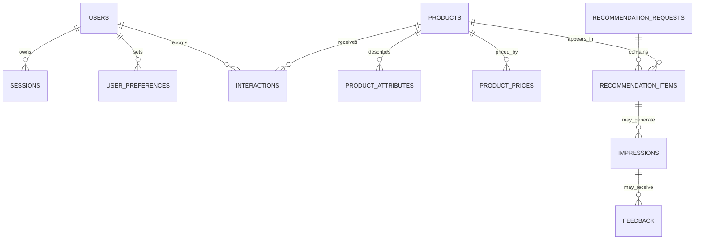

# DATABASE — Schemas, access and lifecycle

**Status:** Proposed schema for PostgreSQL. Names and exact types will be finalized via versioned migrations.

## 1. Data domains

**Online application:** accounts, sessions, explicit preferences, catalog, recommendation requests, impressions, feedback. **Offline analytics:** pseudonymous review events, dataset snapshots, feature tables and model artifacts. Keep these separated logically (and preferably in distinct schemas/stores).

## 2. Proposed core entities

| Table | Required columns / notes | Owner |
|---|---|---|
| `users` | `id` UUID PK, `created_at`, `status`, `consent_version` | Auth/profile service |
| `sessions` | `id` UUID PK, nullable `user_id`, `expires_at`, `created_at` | Session service |
| `products` | `id` UUID PK, `external_ref` nullable, `title`, `category_id`, `brand`, `source_type`, `source_updated_at`, `visibility`, `catalog_version` | Catalog service |
| `product_attributes` | `product_id`, `name`, typed `value`, `unit`, `provenance`, `verified_at` (unique per product/attribute/source) | Catalog service |
| `product_prices` | `product_id`, `currency`, `amount`, `price_type`, `source`, `observed_at`, validity; nullable values handled | Catalog service |
| `user_preferences` | `user_id`, `key`, value, `hard_constraint` flag, `origin`, `consent_scope`, updated timestamp | Profile service |
| `interactions` | `event_id` UUID PK, `user_id`/`session_id`, `product_id`, `event_type`, timestamp, context | Event service |
| `recommendation_requests` | `request_id` UUID PK, actor/session, `model_version`, `catalog_version`, constraints, timestamp | Recommendation service |
| `recommendation_items` | `request_id`, `product_id`, `rank`, `retrieval_sources`, `score`, `explanation_evidence` | Recommendation service |
| `impressions` | `id` UUID PK, `request_id`, `product_id`, `position`, `displayed_at` | Event service |
| `feedback` | `event_id` UUID PK, `impression_id` nullable, `product_id`, event type, timestamp | Event service |
| `agent_sessions` | `id`, actor/session, bounded structured state, timestamps/expiry | Agent service |
| `model_registry` | `model_version`, `artifact_ref`, `dataset_version`, `feature_schema`, `status`, `created_at` | ML service |

Use relational FKs, uniqueness and indexes where appropriate; choose JSONB for bounded flexible fields only, not as a substitute for relational integrity. Store price/currency separately; never mix a historical USD price with an INR budget without an explicit, sourced conversion policy.

## 3. Relationships

## 4. Access matrix

| Actor/service | Catalog | Profile | Interaction log | Model metadata |
|---|---|---|---|---|
| Guest | public readable products | own ephemeral state | own permitted actions | public approved summary |
| Authenticated user | public readable products | own read/write/delete | own read/delete as supported | public approved summary |
| API service | scoped read/write via repository | identity-scoped | append-only/event updates | read active version |
| Offline training | approved pseudonymous snapshot | no secrets/raw auth data | versioned snapshots only | read/write evaluated artifacts |
| Admin | role-scoped catalog changes | tightly limited/audited | aggregated operational access | manage promotion with audit |
| Agent | approved typed tools only | tools limited to caller identity | feedback tool with permission | no direct database access |

## 5. Privacy and deletion

Minimize stored chat transcripts and precise personal information. Clearly separate anonymous guest sessions from registered accounts. Provide deletion for saved preferences and associated eligible interactions according to the final retention policy. Avoid sending full interaction histories to external LLMs when summarized preferences suffice. Encrypt connections; consider field-level protection for sensitive retained values.

## 6. Integrity and migrations

- Use Alembic migrations; never modify applied migrations in place.
- Production schema changes require backward-compatible deploy order and rollback plan.
- Idempotency keys for repeated feedback writes; record impression rank and model/catalog version.
- Use database timestamps in UTC, with explicit display conversion on the client.
- Guard against cross-user access: repository queries always scope by authenticated principal.
- Database backups, restore tests, retention and purge schedules are required before production launch.

## 7. Not yet decided

Final auth integration; retention duration; whether raw conversations are stored; catalog ingestion ownership; exact indexing plan. Resolve in `DECISIONS.md` before implementing sensitive storage.
