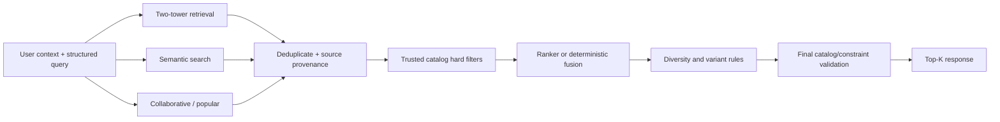

# ML-SYSTEM — Recommender and ranking design

**Status:** Planned model and serving contracts, not trained system.

## 1. ML objective

Given user/session context `u`, current stated constraints `c`, catalog snapshot `D`, return top-K eligible items ordered by predicted relevance. Optimize offline retrieval/ranking quality while monitoring coverage, diversity, latency and truthfulness. Agent language output is **not** the ranking model.

## 2. Baseline ladder

1. **B0 popularity:** top reviewed/relevant training items with a time-aware variant, excluding held-out data.
2. **B1 content:** title+description embeddings / TF-IDF with preference matching; handles item cold start.
3. **B2 collaborative:** implicit ALS/BPR or another documented, reproducible collaborative baseline.
4. **M1 two-tower:** user history/ID representation and item ID+metadata/text representation projected into a shared vector space; similarity-based retrieval.
5. **M2 hybrid:** merge collaborative/semantic/neural candidate lists with RRF or transparent calibrated fusion and track source recall.
6. **M3 ranker:** LightGBM LambdaRank **only if** we can construct valid groupwise relevance labels and unbiased-enough features; otherwise retain deterministic fusion.
7. **Optional research:** SASRec, LightGCN or contextual bandit after v1, not preconditions.

Phase 3.1 implements an initial deterministic B0 from positive training review
counts (rating >=4), with stable item-key tie-breaking and train-seen exclusion.
It is an offline baseline over the Step 2.5 train-known candidate pool; review
counts are not purchase or exposure counts. No trained model is part of this
milestone.

Phase 3.2A adds a pure item-based collaborative filtering baseline (B2a) over
binary train-only user-item signals: ratings >=4 are positive, and repeated
positive observations for the same user/item are collapsed only in this
derived representation. Cosine similarities are computed from sparse
co-occurrence counts; pairs with fewer than two shared users are discarded.
Each user's positive history is capped at 20 items ordered by global training
positive-user count descending and item key ascending; at most 100 neighbors
per item are retained, ordered by similarity descending and item key ascending.
Recommendation scores sum similarities from the user's capped positive
history. All train-observed items are excluded, and the candidate pool must be
the exact train-known item set. This baseline has no popularity fallback:
users without generated candidates receive fewer than K results, which is
reported as candidate-generation coverage and per-K shortfall. This is a
deterministic bounded baseline, not a trained or promoted model.

### CPU-first PyTorch for offline BPR

PyTorch is pinned to release `torch==2.15.0` in the existing `dev` dependency
group. BPR training is an offline research job, so the current API runtime
does not acquire the large ML framework dependency. The project pins this
version and its artifact hashes in `uv.lock`; updates must use uv's resolver
and lock workflow. uv maps only `torch` to the named, explicit official
[PyTorch CPU wheel index](https://download.pytorch.org/whl/cpu); ordinary
dependencies continue to use PyPI. No CUDA, `torchvision`, or `torchaudio`
package is included.

The forthcoming BPR baseline is intended to train and evaluate on CPU first.
The lock selects the `+cpu` wheel for Windows/Linux, which provides CPU tensor
and autograd operations and does not include CUDA support. Correct execution
must not depend on CUDA being available. The current development target is
CPython 3.13 on Windows x86-64 and Linux x86-64 (including the Ubuntu 24.04 CI
runner). The official CPU index also publishes a CPython 3.13 Apple Silicon
macOS wheel, but does not list a matching macOS Intel wheel; macOS Intel
support is therefore not promised. Other architectures must be checked against
the wheel index before use.

Training remains an offline concern. If a future serving implementation
requires PyTorch inference, review that dependency separately rather than
pulling the training stack into the API runtime by default. Store model
checkpoints only in ignored local artifact paths and load them only with
verified provenance; a CPU-only installation provides no GPU acceleration.

## 3. Two-tower details

**User tower:** trainable ID embedding for seen users, aggregated historical item embeddings and explicit preference feature vector (when available). Support anonymous query/session via metadata/context encoder or fallback; no assumption that historical review users map to app users.

**Item tower:** item ID embedding plus frozen/precomputed text features and normalized categorical/spec features; combine with a small MLP. For unseen items, design a metadata-only path rather than relying on a nonexistent trained ID embedding.

**Scoring:** `s(u,i) = dot(normalize(user_vector), normalize(item_vector))` is an initial option; tune normalization/temperature. Initial dimensions 64/128 are search candidates, not promises. Train with sampled-softmax/contrastive or pairwise objectives and defined negative-sampling strategy. In-batch negatives may contain false negatives. Separate train and inference feature transformations.

**Index:** export item embeddings with model/corpus version, vector dimensionality and IDs; build ANN index; reindex when incompatible embeddings or product set change. Semantic text vector and neural collaborative vector require separate named spaces/collections or fields.

## 4. Hybrid retrieval pipeline

Start with a bounded candidate pool (illustrative: 100 per retriever), configurable limits and timeouts; deduplicate by canonical product and optionally product-family ID. Do not let an ANN result bypass catalog visibility or price checks. If price unknown and max price is hard, exclude or mark unqualified, **not** assume affordable.

## 5. Ranking features and label integrity

Candidate features: per-retriever score/rank, metadata match, category match, explicit preference alignment, historical affinity, popularity from training only, recency derived as-of cutoff, optional price compatibility from trusted catalog. Group features per user/request context; do not leak evaluation interactions through review counts or popularity. Collect proper per-query relevance labels before LambdaRank. Log training-vs-serving feature parity. Raw neural scores are not calibrated probabilities.

## 6. Feedback adaptation and retraining

Online likes/dislikes may update short-term session preferences and deterministic reranking immediately; they do **not** imply the trained Two-Tower weights update per click. Retraining uses versioned snapshots and explicit model promotion after evaluation. Exposure bias: log what was shown, at which position, with which model and candidate pool.

## 7. Serving fallback and SLO targets

- If personalized tower unavailable or user unseen: content + popular fallback.
- If ANN/vector DB unavailable: collab/popular with transparent fallback metadata.
- If ranker unavailable: deterministic RRF; final hard filters still mandatory.
- If catalog data unavailable: return service error, not invented product cards.
- Initial planning targets: cached feed P95 <300 ms; retrieval+rerank P95 <800 ms, excluding LLM; benchmark environment must be documented.

## 8. Artifact manifest

`model_version`, `source_commit`, `dataset_manifest_hash`, `split_id`, `config_hash`, `feature_schema_version`, `vocab_hash`, `embedding_dim`, `index_version`, `metrics_report_uri`, `evaluation_run_id`, `created_at`, `promotion_status`. Verify compatibility at load time.

## 9. Promotion policy

A candidate must pass schema/parity tests, leakage checks, latency and constraint tests, and be compared to strongest simple baseline with uncertainty estimates. If model is worse, keep previous version and document it. No automatic rollout solely because an experiment completed.
