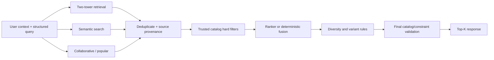

# ML-SYSTEM — Recommender and ranking design

**Status:** Phase 3.2B.2 BPR and Phase 3.3B Two-Tower have local
validation-only Electronics experiments, followed by the Phase 3.3C controlled
four-model analysis. Phase 3.3A provides the synthetic implementation and
regression tests. No model is promoted for serving.

## 1. ML objective

Given user/session context `u`, current stated constraints `c`, catalog snapshot `D`, return top-K eligible items ordered by predicted relevance. Optimize offline retrieval/ranking quality while monitoring coverage, diversity, latency and truthfulness. Agent language output is **not** the ranking model.

## 2. Baseline ladder

1. **B0 popularity:** top reviewed/relevant training items with a time-aware variant, excluding held-out data.
2. **B1 content:** title+description embeddings / TF-IDF with preference matching; handles item cold start.
3. **B2 collaborative:** implicit ALS/BPR or another documented, reproducible collaborative baseline.
4. **M1 two-tower:** user history/ID representation and item ID+metadata/text representation projected into a shared vector space; similarity-based retrieval.
5. **M2 hybrid:** merge collaborative/semantic/neural candidate lists with RRF or transparent calibrated fusion and track source recall.
6. **M3 ranker:** LightGBM LambdaRank **only if** we can construct valid groupwise relevance labels and unbiased-enough features; otherwise retain deterministic fusion.
7. **Optional research:** SASRec, LightGCN or contextual bandit after v1, not preconditions.

Phase 4.3A adds a synthetic-only sparse TF-IDF content retriever in
`recfusion_ml.retrieval.content`. It uses the bounded canonical content fields
and conservative normalized metadata documented in `docs/CONTENT-RETRIEVAL.md`.
Vocabulary and IDF fit on an explicit reference catalog; candidates are
transformed without affecting those statistics. User profiles use unique,
strictly prior positive training items, exclude the target item, and retain all
prior observations for seen-item filtering. No real product metadata was used
for this implementation or its tests. The text vector space remains distinct
from collaborative and Two-Tower embeddings.

Phase 4.3B adds a deterministic synthetic benchmark for that retriever. It
compares fixed profile and item-content controls with local popularity and
seeded-random controls under separate warm-only and content-eligible candidate
policies. The benchmark fits only on its synthetic warm reference catalog and
reports cold-item eligibility, metadata diagnostics, and aggregate metrics;
it does not alter the Phase 3 evaluator or use real Amazon data. See
`docs/CONTENT-BENCHMARK.md` for its protocol and limitations.

Phase 3.1 implements an initial deterministic B0 from positive training review
counts (rating >=4), with stable item-key tie-breaking and train-seen exclusion.
It is an offline baseline over the Step 2.5 train-known candidate pool; review
counts are not purchase or exposure counts. No trained model is part of this
milestone.

Phase 3.2A adds a pure item-based collaborative filtering baseline (B2a) over
binary train-only user-item signals: ratings >=4 are positive, and repeated
positive observations for the same user/item are collapsed only in this
derived representation. Cosine similarities are computed from sparse
co-occurrence counts; pairs with fewer than two shared users are discarded.
Each user's positive history is capped at 20 items ordered by global training
positive-user count descending and item key ascending; at most 100 neighbors
per item are retained, ordered by similarity descending and item key ascending.
Recommendation scores sum similarities from the user's capped positive
history. All train-observed items are excluded, and the candidate pool must be
the exact train-known item set. This baseline has no popularity fallback:
users without generated candidates receive fewer than K results, which is
reported as candidate-generation coverage and per-K shortfall. This is a
deterministic bounded baseline, not a trained or promoted model.

### CPU-first PyTorch for offline BPR

PyTorch is pinned to release `torch==2.15.0` in the existing `dev` dependency
group. BPR training is an offline research job, so the current API runtime
does not acquire the large ML framework dependency. The project pins this
version and its artifact hashes in `uv.lock`; updates must use uv's resolver
and lock workflow. uv maps only `torch` to the named, explicit official
[PyTorch CPU wheel index](https://download.pytorch.org/whl/cpu); ordinary
dependencies continue to use PyPI. No CUDA, `torchvision`, or `torchaudio`
package is included.

The BPR baseline and Two-Tower implementation run on CPU first.
The lock selects the `+cpu` wheel for Windows/Linux, which provides CPU tensor
and autograd operations and does not include CUDA support. Correct execution
must not depend on CUDA being available. The current development target is
CPython 3.13 on Windows x86-64 and Linux x86-64 (including the Ubuntu 24.04 CI
runner). The official CPU index also publishes a CPython 3.13 Apple Silicon
macOS wheel, but does not list a matching macOS Intel wheel; macOS Intel
support is therefore not promised. Other architectures must be checked against
the wheel index before use.

Training remains an offline concern. If a future serving implementation
requires PyTorch inference, review that dependency separately rather than
pulling the training stack into the API runtime by default. A CPU-only
installation provides no GPU acceleration.

#### Step 3.2B.1 BPR implementation

`recfusion_ml.models.implicit_mf.ImplicitMF` provides trainable user and item
embeddings and dot-product scores. The model is trained on CPU with Adam. The
pairwise objective is the mean `softplus(score(u, negative) -
score(u, positive))`; the configured L2 term adds the mean squared norms of
the sampled user, positive-item, and negative-item embeddings, scaled by the
regularization coefficient. Non-finite scores, loss, gradients, and parameters
raise errors instead of being silently propagated.

`fit_bpr` accepts **training-split events only**. It builds sorted user/item
vocabularies from those events, takes ratings >=4 as positive observations,
and deduplicates repeated positive user/item pairs in this derived training
view. Ratings 1-2 remain observed history and rating 3 remains neutral; both
exclude an item from that user's negative candidates. One negative is sampled
per distinct positive pair each epoch from train-known items not observed for
that user. Sampling uses a fixed seed, sorted candidates, bounded rejection,
and a seeded deterministic scan fallback. Users with no permissible negative
are skipped and counted; training errors if no triplets can be formed. A
sampled unobserved item is a BPR training assumption, not a verified dislike.

The defaults are 32 dimensions, 20 epochs, batches of 1,024 triplets, Adam
learning rate 0.001, L2 coefficient 0.0001, seed 42, and 16 bounded negative
rejection attempts before the seeded scan fallback. Training-example
ordering, initialization, and negative sampling are seed-controlled and
independent of input-row order. Reproducibility is expected within the pinned
CPU/PyTorch environment; exact bitwise results across different PyTorch
versions, platforms, or CPU implementations are not guaranteed.

Scoring uses train-known items only, scores candidates in bounded chunks,
excludes every item observed by the user in training (including low/neutral
ratings), and sorts by score descending then canonical item ID ascending.
Unknown users yield no recommendations; direct scoring rejects unknown users
and items. This interface can provide candidate rankings to the Phase 3.1
evaluator, but this implementation step does not evaluate validation or test.

Checkpoints are written atomically only beneath ignored `data/processed/` and
are never public model artifacts. They contain the architecture/training
configuration, train-only ordered identifier vocabularies and seen-item sets,
training-view SHA-256 fingerprint, optional caller-supplied source artifact
SHA-256 fingerprints, sampling strategy, summary, epoch losses, PyTorch
version, and tensor state. The training-view fingerprint covers the sorted
user/item/rating event triples; it is not a raw-source file checksum. Loading
is CPU-mapped and uses `weights_only=True`; arbitrary
Python object deserialization is not enabled. Identifier mappings and learned
embeddings remain local and private. The current tests use only small
synthetic events: they verify score/loss gradients, deterministic fitting,
sampling exclusions, duplicate-pair handling, ranking behavior, leakage
rejection, and checkpoint score equivalence. No real Amazon data or
validation/test artifact has been used by these tests. The real-data
validation-only experiment is documented below and in `docs/EVALUATION.md`.

#### Step 3.2B.2 real Electronics BPR experiment

The local 10,000-user Electronics pilot was trained on CPU with seed 42,
32-dimensional embeddings, Adam (learning rate 0.001), L2 regularization
0.0001, batches of 1,024, and 20 epochs. Training used the 81,688 trusted train
records only; BPR used 65,842 distinct positive pairs, with 65,842 sampled
triplets per epoch and no positive pairs skipped for lack of a negative
candidate. The fixed train-known item universe was used for validation ranking,
all train-seen items were excluded, and validation NDCG@10 selected epoch 13.
The official test rows were not parsed or evaluated. Their source artifact
checksum was verified from the trusted manifest.

The saved local checkpoint and aggregate-only report are ignored under
`data/processed/amazon-electronics-pilot-10000-bpr-v1/`. The checkpoint is
private and must not be published. On this CPU run, checkpoint size was
18,298,757 bytes (the report directory totals 18,323,345 bytes).
Training-process peak memory and end-to-end wall time were unavailable because
the run stopped during report assembly; a later recovery process finalized the
report from the verified checkpoint and epoch log. That recovery process
peaked at 661,909,504 bytes working set. Recorded epoch
validation durations total 2,552 seconds, including an anomalous 1,410-second
duration for epoch 2 that coincided with execution-session disruption; do not
use these aggregate durations for capacity planning. No SQLite temporary
database was used. Metrics and protocol details are recorded in
`docs/EVALUATION.md` and the ignored report. This validation run has no
confidence intervals or significance analysis and does not establish
generalization or deployment readiness.

## 3. Two-tower details

#### Step 3.3A synthetic implementation

`recfusion_ml.models.two_tower.TwoTowerNetwork` is a distinct two-tower
retriever, not the BPR embedding-dot-product model. The user tower concatenates
a train-known user identity embedding with the mean of that user's prior
training-item history embeddings, then applies a configurable GELU MLP
projection. The separate item tower maps a train-known item identity embedding
through its own MLP projection. Both produce vectors of the configured
retrieval dimension and score by their dot product. The item tower can encode
items independently of a user request. This ID-only item tower does not
support content-based cold-item retrieval.

User and item vocabularies are fit from eligible train-split events only,
sorted deterministically, and assigned indices starting at 1. Index 0 is
reserved for padding and is initialized to zero. The history encoder mean-pools
unique item IDs from a maximum of 50 most-recent prior items; it uses prior
observations regardless of their rating. A training target uses only events
whose `event_time_ms` is strictly earlier than the target. Equal-time events
are simultaneous and do not enter one another's histories. The target item is
masked from its own history even if an earlier event for that item exists.
Repeated positive user/item targets are collapsed to their earliest positive
event, and repeated items in history are represented once using their latest
prior timestamp. Step 2.5-ineligible rows are excluded. An empty history is a
zero pooled vector, while the user identity remains available.

The training target is one distinct train user/item pair with rating >=4. Each
example uses up to four distinct negatives sampled from train-known items that
the user has never observed in train; the existing bounded, seeded negative
sampler is reused. No in-batch negatives are used. The loss is sampled
softmax/cross-entropy over one positive and the available sampled negatives,
with logits divided by temperature 0.1 and the positive in column zero. A
masked padding column is excluded from the loss when a user's available
negative count is below the configured maximum. The configured L2 penalty is
applied to active user, positive-item, and negative-item retrieval vectors.
An unobserved item remains an unknown signal, not a verified dislike, and can
still be a false negative because the source has no exposure labels.

Training uses deterministic mini-batch ordering and CPU initialization with
seed 42 by default. Defaults are 32-dimensional ID/history embeddings, one
64-unit hidden layer per tower, a 32-dimensional retrieval space, 10 epochs,
batch size 128, Adam at 0.001, L2 coefficient 0.0001, and a 50-item history
cap. Loss and gradient finiteness are checked; epoch statistics record the
sampled-softmax, regularization, total loss, example/negative counts, and
duration. Storage is sparse in observed interactions rather than a dense
user/item matrix; histories are capped and negatives are bounded per example.
The model and training regression tests use synthetic events only. The
separate Step 3.3B pilot used only the verified local train and validation
artifacts. Exact reproducibility is expected for the pinned CPU/PyTorch
environment and fixed inputs/config; bitwise equality across PyTorch versions,
platforms, or CPU implementations is not promised.

`TwoTowerRecommender.recommend_many` returns rankings compatible with the
existing evaluator. It scores the exact train-known candidate pool in bounded
chunks, uses a train-only final user history, excludes every train-observed
item, and breaks ties by canonical item ID. Unknown users return no results;
direct score or item-vector requests for unknown IDs fail explicitly. Checkpoints
are weights-only CPU artifacts written only under ignored `data/processed/` and
retain private vocabularies, seen-item/history state, the training fingerprint,
source artifact fingerprints, configuration, epoch statistics, and PyTorch
version. Step 3.3A tests use synthetic data. The Step 3.3B checkpoint and
aggregate report are local-only under ignored
`data/processed/amazon-electronics-pilot-10000-twotower-v1/`; no row-level
predictions are persisted.

#### Step 3.3B real Electronics Two-Tower experiment

The run used the existing 10,000-user trusted split. Train and validation
artifacts matched their manifest SHA-256 hashes. Training used 81,688 train
records, 10,000 users, 45,331 train-known items, 65,842 distinct positive
targets, and four sampled train-unobserved items per target (263,368
negatives per epoch, with none skipped). All 65,842 target histories passed
the strict-prior, target-masking, and stable-order audit; 7,806 targets had an
empty history. Validation used the frozen 1,369 warm-positive users and 1,911
targets. The 3,153 cold-item positive observations were excluded by the
existing train-known candidate protocol. Validation/test records and ratings
were not model inputs; the official test rows were not parsed or evaluated.

The single CPU configuration was seed 42, 32-dimensional embeddings and
retrieval vectors, a 64-unit hidden layer, 50-history-item cap, batch size 256,
four negatives, temperature 0.1, Adam at 0.001, L2 0.0001, and 20 epochs.
The implementation has no dropout or weight-decay option. Macro validation
NDCG@10 with earliest-epoch tie-breaking selected epoch 2 (0.015572). Training
loss fell from 1.529707 to 0.074736 by epoch 20 while validation NDCG@10 fell
after epoch 2 and remained low. This is a clear overfitting/concentration
signal for this configuration, not evidence of generalization.

At K=10, Two-Tower Recall/NDCG/HitRate/MRR were
0.025889/0.015572/0.033601/0.014899, compared with popularity
0.022784/0.009878/0.029949/0.006866, item-CF
0.005990/0.003259/0.008035/0.002870, and BPR
0.011566/0.005384/0.013148/0.003633. Despite those validation metrics, the
Two-Tower returned only 31 distinct items among 13,690 K=10 recommendations
(candidate coverage 0.000684); at K=20 it returned 60 distinct items among
27,380 recommendations. This severe catalog concentration is a major
limitation. The full comparison at K=5/10/20 is recorded in
`docs/MODEL-COMPARISON.md` and the ignored aggregate report. Paired user
bootstrap intervals are exploratory, unadjusted, and conditional on neural
checkpoints selected on the same validation cohort; they do not remove
selection optimism.

The resource preflight measured one full training epoch at 8.745 seconds and
one full-catalog pass at 29.560 seconds. The 20-epoch run recorded 813.209
seconds for data setup, training, and per-epoch validation; the selected
checkpoint reload/full validation took 26.981 seconds. Peak working set was
780,886,016 bytes; the best checkpoint is 18,212,678 bytes. These measurements
describe this local run and are not capacity guarantees. No product metadata
was joined, so cold-item retrieval and metadata coverage remain unsupported.

#### Step 3.3B.1 saved-checkpoint diagnostics

The saved epoch-2 checkpoint was verified against its SHA-256, the trusted
train/validation artifact hashes, both manifests, and rebuilt train-only
vocabulary/history state. The validation cohort remains 1,369 users, 1,911
eligible positive targets, and the exact 45,331 train-known candidates. No
model was retrained, and test rows were not parsed or evaluated.

No ranking implementation defect was found. On a deterministic 16-user
comparison, `recommend_many` matched single-user ranking. The multi-user path
preserves sorted item-vector indexing, user-specific vectors, seen-item
exclusion, descending-score/key tie-breaking, and bounded chunks. The item
vector cache is local to each `recommend_many` call, so loading a different
checkpoint cannot reuse stale cached vectors. Synthetic regression tests now
cover per-user ranking, item mapping, ties, seen-item filtering, chunk-size
invariance, and refreshed vectors.

The concentration is measurable but not unique to Two-Tower: the same-cohort
popularity control recommended 15 unique items at K=10, versus 31 for
Two-Tower. At K=10, the top 10 items account for 93.02% of Two-Tower placements
and 98.24% for popularity. Full-catalog normalized entropy was 0.2293 versus
0.2200; Gini was 0.999770 versus 0.999776. These Gini values include all
45,331 candidates, including zero-frequency items. Mean sampled pairwise K=10
list overlap was 0.900 for Two-Tower and 0.961 for popularity (128
deterministically sampled users; overlap is intersection divided by the
shorter list length). Two-Tower recommendation frequency had Pearson
correlation 0.593 with train positive-review counts. At K=10 it shared 11 of
its 31 unique items with popularity; mean per-user list overlap was 0.791.
Thus the model has some user-specific ordering, but remains strongly
concentrated around popular items.

Empty-history inference retained the same candidate pool and train-seen
filter. Its K=10 Recall/NDCG were 0.026254/0.015737, compared with
0.025889/0.015572 using train histories; coverage fell from 31 unique items
to 15. Normal and empty-history K=10 lists overlapped by 0.973 on average.
Across 256 deterministic sampled users, normal and empty-history vectors had
mean cosine 0.972 and mean coordinate absolute difference 0.0172. This
confirms that history changes representations, while its effect on rankings
is small in this saved checkpoint. It does not establish why the history
signal is weak.

Representation summaries used 256 sampled user vectors and 1,024 sampled item
vectors. Mean pairwise cosine was 0.812 for normal-history users (p95 0.976),
0.911 for empty-history users, and 0.250 for item vectors (median 0.501, p95
0.943). Sampled user-item scores had mean -0.0268, population variance
0.00211, median -0.0308, p05 -0.0865, and p95 0.0431. Adjacent sorted sample
scores were near-equal within 1e-6 in 1.17% of comparisons and exactly equal
in 0.0034%. These statistics do not, individually or together, establish
representation collapse.

The existing 20-epoch log shows training loss falling from 1.5297 (epoch 1)
to 0.07474 (epoch 20); validation NDCG@10 peaked at epoch 2 (0.015572), fell
to 0.009573 at epoch 3, and was 0.001794 at epoch 20. Per-epoch catalog
coverage was not recorded and is unavailable. This is evidence consistent
with overfitting, but not evidence of its cause. The aggregate-only diagnostic
report is private under ignored
`data/processed/amazon-electronics-pilot-10000-twotower-diagnostics-v1/diagnostics-v3.json`.
It contains no IDs, embeddings, or recommendation lists. Sampling seed is
33031; exact selection and additional aggregates are recorded there.

The following serving and metadata directions remain planned rather than
implemented:

**User tower:** trainable ID embedding for seen users, aggregated historical item embeddings and explicit preference feature vector (when available). Support anonymous query/session via metadata/context encoder or fallback; no assumption that historical review users map to app users.

**Item tower:** item ID embedding plus frozen/precomputed text features and normalized categorical/spec features; combine with a small MLP. For unseen items, design a metadata-only path rather than relying on a nonexistent trained ID embedding.

**Scoring:** `s(u,i) = dot(normalize(user_vector), normalize(item_vector))` is an initial option; tune normalization/temperature. Initial dimensions 64/128 are search candidates, not promises. Train with sampled-softmax/contrastive or pairwise objectives and defined negative-sampling strategy. In-batch negatives may contain false negatives. Separate train and inference feature transformations.

**Index:** export item embeddings with model/corpus version, vector dimensionality and IDs; build ANN index; reindex when incompatible embeddings or product set change. Semantic text vector and neural collaborative vector require separate named spaces/collections or fields.

### Phase 3.4A deterministic rank fusion

The synthetic-only Phase 3.4A implementation fuses ranked candidate lists with
weighted Reciprocal Rank Fusion:
`score(item) = sum(weight(source) / (rank_constant + one_based_rank))`.
Raw model scores are not combined or normalized. The default rank constant is
60; per-source candidate depth is independently configurable and defaults to
the full supplied list. A configured depth truncates by original rank before
catalog or seen-item filtering, so filtering never promotes a lower-ranked
item. Duplicate item IDs within one source list are rejected.

Only candidates in the caller-supplied train-known pool can be returned, and
the user's train-seen items are excluded. A zero-weight source cannot add
candidates. Missing and empty sources contribute zero; there is no implicit
popularity fallback and an empty fused list remains empty. Source provenance,
per-source RRF contributions, raw/eligible/truncated/excluded counts, eligible
union size, and pairwise Jaccard overlap on candidates remaining after depth,
catalog, and seen-item filters are retained for audit. Stable source iteration
and canonical item-key tie-breaking make results independent of mapping
insertion order. Aggregate diagnostics distinguish eligible-union
coverage from coverage in final top-K lists, report users with short lists,
catalog-frequency buckets, top-item placement shares, and source attribution.
Mean source disagreement is reported as one minus Jaccard overlap. Aggregate
diagnostics do not emit row-level identities.

Phase 3.4B executed two predeclared equal-weight RRF validation experiments:
popularity + item-CF + BPR + Two-Tower, and Two-Tower + BPR, using rank
constant 60 and source depth 100. No weights were tuned; missing source
outputs received no fallback. The Phase 3.3C validation cohort, train-known
candidate pool, metric denominator, and seen-item exclusions stayed fixed.
The K=10 NDCG scores were 0.009649 and 0.009890, with 106 and 299 unique
recommended items (0.2338% and 0.6596% catalog coverage). Neither result
establishes improved ranking quality: the equal-four result was below
popularity, Two-Tower+BPR was statistically indistinguishable from popularity
under the paired interval, and both were below the validation-selected
Two-Tower checkpoint. These are exploratory results conditional on the
existing validation-selected checkpoints, with unadjusted comparisons and
sparse targets. The reserved test split was not parsed or evaluated. See
`docs/MODEL-COMPARISON.md` for the aggregate results and uncertainty. Fusion
does not supply cold-item candidates, product metadata, or commercial
evidence.

## 4. Hybrid retrieval pipeline

Start with a bounded candidate pool (illustrative: 100 per retriever), configurable limits and timeouts; deduplicate by canonical product and optionally product-family ID. Do not let an ANN result bypass catalog visibility or price checks. If price unknown and max price is hard, exclude or mark unqualified, **not** assume affordable.

## 5. Ranking features and label integrity

Candidate features: per-retriever score/rank, metadata match, category match, explicit preference alignment, historical affinity, popularity from training only, recency derived as-of cutoff, optional price compatibility from trusted catalog. Group features per user/request context; do not leak evaluation interactions through review counts or popularity. Collect proper per-query relevance labels before LambdaRank. Log training-vs-serving feature parity. Raw neural scores are not calibrated probabilities.

## 6. Feedback adaptation and retraining

Online likes/dislikes may update short-term session preferences and deterministic reranking immediately; they do **not** imply the trained Two-Tower weights update per click. Retraining uses versioned snapshots and explicit model promotion after evaluation. Exposure bias: log what was shown, at which position, with which model and candidate pool.

## 7. Serving fallback and SLO targets

- If personalized tower unavailable or user unseen: content + popular fallback.
- If ANN/vector DB unavailable: collab/popular with transparent fallback metadata.
- If ranker unavailable: deterministic RRF; final hard filters still mandatory.
- If catalog data unavailable: return service error, not invented product cards.
- Initial planning targets: cached feed P95 <300 ms; retrieval+rerank P95 <800 ms, excluding LLM; benchmark environment must be documented.

## 8. Artifact manifest

`model_version`, `source_commit`, `dataset_manifest_hash`, `split_id`, `config_hash`, `feature_schema_version`, `vocab_hash`, `embedding_dim`, `index_version`, `metrics_report_uri`, `evaluation_run_id`, `created_at`, `promotion_status`. Verify compatibility at load time.

## 9. Promotion policy

A candidate must pass schema/parity tests, leakage checks, latency and constraint tests, and be compared to strongest simple baseline with uncertainty estimates. If model is worse, keep previous version and document it. No automatic rollout solely because an experiment completed.
